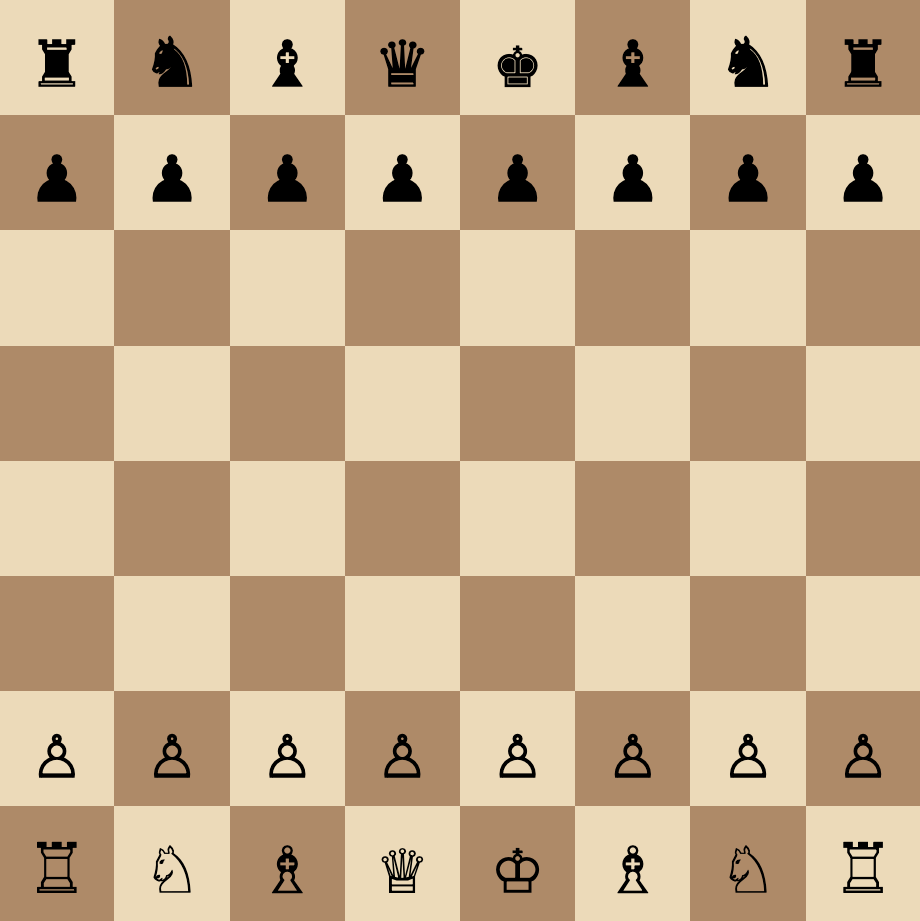

# Chess




An educational chess application built with vanilla JavaScript and Vite. The project serves as a frontend-oriented JavaScript warmup, exploring DOM rendering, state modeling, and incremental feature delivery. Development is organized into iterative sprints, each surfaced as a dedicated commit in the history.

## Getting started

Prerequisites: Node.js 18+ and npm.

```
npm install
npm run dev
```

## Project structure

```
chess/
├── index.html        # Application entry point
├── public/           # Static assets served as-is
└── src/              # Application source (modules, styles, assets)
```
