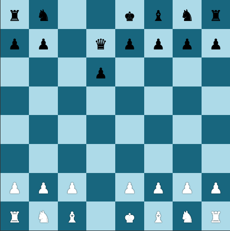

<div align="center">


<h3>chess</h3>

</div>


An educational chess application, now being ported to **React** as a frontend warmup for the Front-End Engineering course. The original vanilla JavaScript implementation is archived on the [`vanilla`](https://github.com/danlerr/chess/tree/vanilla) branch. Both versions share the same pure game logic under `src/core/`; only the rendering layer changes. Development is organized into iterative sprints, each surfaced as a dedicated commit in the history.

Pieces set: "cburnett" by Colin M.L. Burnett, Lichess (GPLv2+).

## Getting started

Prerequisites: Node.js 18+ and npm.

```
npm install
npm run dev
```

## Project structure

```
chess/
├── index.html        # Vite entry point
├── public/           # Static assets served as-is
└── src/
    ├── core/         # Pure game logic (board, pieces, moves) — shared with vanilla
    ├── components/   # React UI components
    ├── App.jsx       # Root component, holds game state
    └── main.jsx      # React entry point
```